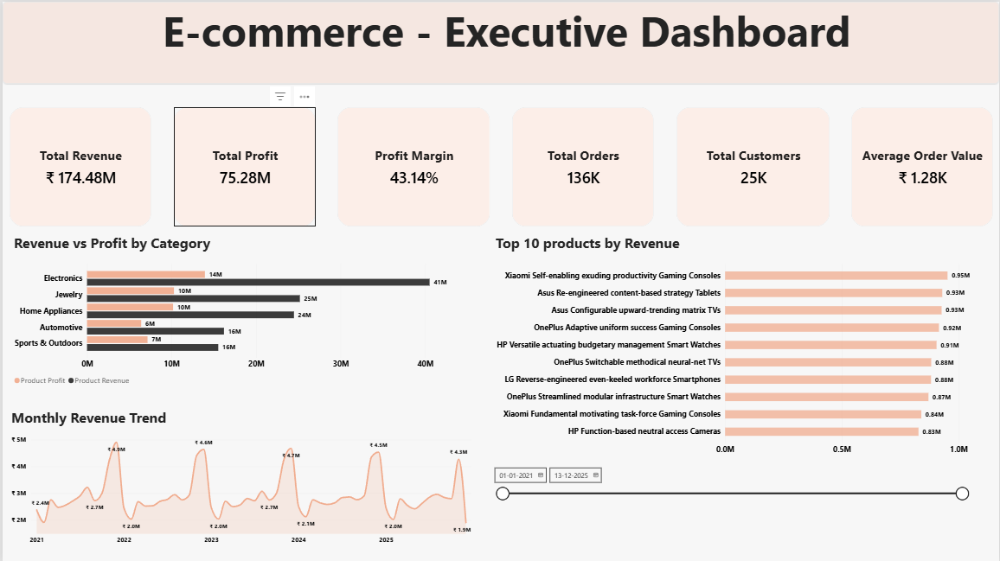
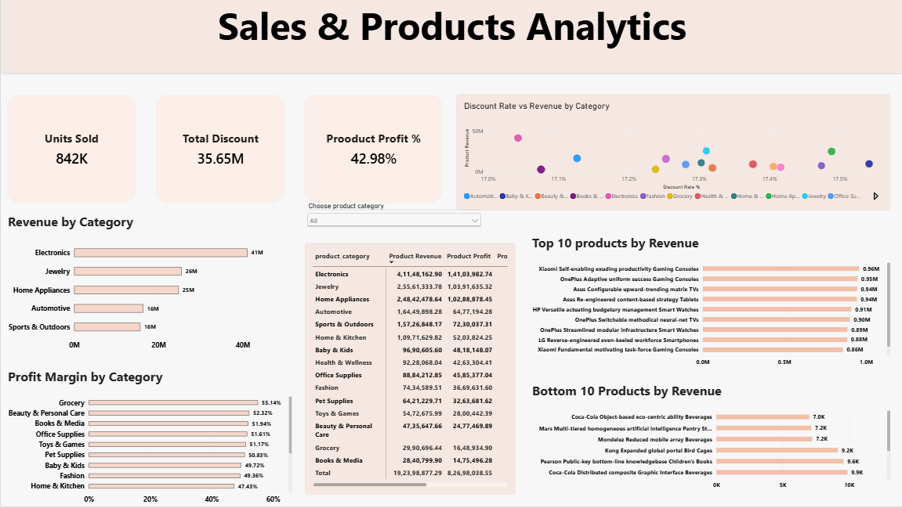
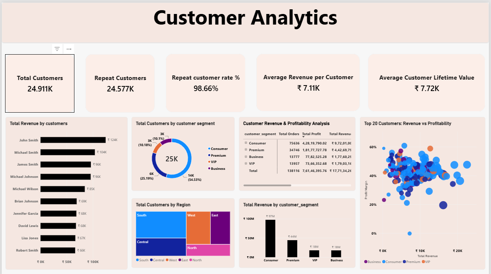
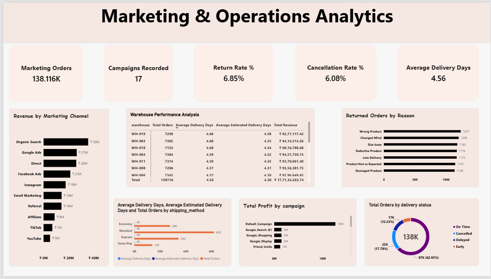

# E-Commerce Sales, Customer & Profitability Analytics

An end-to-end analytics project that takes raw e-commerce data from **PostgreSQL** through **SQL analysis** and **Python EDA** to a **4-page Power BI dashboard**, answering questions about revenue, profit, products, customers, marketing and delivery operations.

**Tools:** PostgreSQL · SQL (CTEs, window functions, views) · Python (Pandas, NumPy, Matplotlib) · Google Colab · Power BI (Power Query, DAX)

---

## Project at a glance

| Metric | Value |
|---|---|
| Orders | **138,116** |
| Customers (placed at least one order) | **24,911** |
| Net sales | **177.13M** |
| Total profit | **76.15M** |
| Profit margin | **42.99%** |
| Average order value | **1,282.50** |
| Return rate | **6.85%** |
| Cancellation rate | **6.08%** |
| Loss-making orders | **1,296 (0.94%)** |
| Period covered | January 2021 to December 2025 |

*Monetary values are summed as recorded in the `net_sales` and `profit` columns (see [Limitations](#limitations)).*

---

## Business questions

1. How much revenue and profit does the business generate, and how do they change over time?
2. Which product categories and products drive revenue, and which are the most profitable?
3. Who are the most valuable customers, and how many customers come back?
4. Which sales channels and marketing channels perform best?
5. How often are orders returned or cancelled, and why?
6. How reliable is delivery, and which shipping methods or warehouses fall behind?
7. Which orders lose money?

---

## Workflow

```text
Raw CSV data  →  PostgreSQL tables  →  Data-quality checks  →  SQL business analysis
              →  Reusable SQL views  →  Python EDA (Google Colab)  →  Power BI dashboard  →  Insights
```

---

## Repository structure

```text
├── README.md
├── SQL/
│   ├── create_table_query.sql        Creates raw_orders, raw_customers, raw_products, raw_order_items
│   ├── data_quality_checks.sql       Row counts, duplicate IDs, missing fields, invalid values
│   ├── business_performance.sql      KPIs, monthly trend, category performance, top products
│   ├── customer_analysis.sql         Customer revenue, repeat customers, profitability, segmentation
│   ├── products_and_categories.sql   Rankings, MoM / YoY growth, running totals, window functions
│   └── views.sql                     Five reusable views for reporting
├── python/
│   └── Ecommerce_Sales_Customer_Profitability_Analytics.ipynb
└── screenshots/                      Dashboard page images
```

---

## SQL analysis (PostgreSQL)

| File | What it does |
|---|---|
| `create_table_query.sql` | Defines the four raw tables (orders has 46 columns). |
| `data_quality_checks.sql` | Row counts per table, duplicate order IDs, missing key fields, negative sales / profit / quantity, invalid delivery days. |
| `business_performance.sql` | Executive KPIs, revenue and profit by month, category revenue / profit / margin, profit contribution, top 10 products by revenue and by margin. |
| `customer_analysis.sql` | Revenue and orders per customer, top customers by revenue and profit, repeat customers, customers with high revenue but low margin, profitability classification and VIP segmentation. |
| `products_and_categories.sql` | Top products, category share of revenue, month-over-month growth, year-over-year revenue, running totals, ranking products within each category, revenue rank vs profit rank, customer ranking by segment. |
| `views.sql` | `vw_monthly_sales`, `vw_product_performance`, `vw_customer_summary`, `vw_marketing_performance`, `vw_operations_performance`. |

**Techniques used:** `JOIN`, `GROUP BY`, `HAVING`, subqueries, CTEs, `CASE`, `FILTER`, window functions (`RANK`, `LAG`, running totals), views.

The views form a clean layer between the raw tables and the Power BI dashboard.

---

## Python EDA (Google Colab)

The notebook has 43 cells, 8 charts and saved outputs. It covers:

1. Loading the three CSV files and validating shape and data types
2. Missing-value analysis
3. Date preparation and KPI calculation
4. Data-quality checks
5. Monthly sales and profit trend
6. Sales channel and customer segment analysis
7. Customer analytics and repeat-customer analysis
8. Product and category analysis
9. Marketing channel and campaign performance
10. Returns analysis
11. Delivery and warehouse performance
12. Loss-making order analysis
13. Best and weakest periods and written business insights

To run it, open the notebook in Google Colab and upload the three CSV files when asked.

---

## Key findings

### Overall performance
- The business generated **177.13M** in net sales and **76.15M** in profit from **138,116** orders and **24,911** customers, a **42.99%** margin.
- The average order value is **1,282.50**, and the average customer spent about **7,111**.

### Sales trend and seasonality
- Revenue peaks at year end. **December 2021 was the best month** (4.90M revenue, 1.63M profit, 3,568 orders), about twice a typical January to October 2021 month (average 2.66M).
- **February 2021 was the weakest month** (1.91M revenue, 0.90M profit, 1,565 orders).

### Products and categories
- **Electronics is the top category by revenue** (41.15M from 55,784 units and 78 products) but has the **lowest margin of all 15 categories, 34.28%**.
- Margins are highest in smaller categories: **Grocery 55.14%**, Beauty & Personal Care 52.32%, Books & Media 51.94%.
- The top product by revenue is *Xiaomi Self-enabling exuding productivity Gaming Consoles* (0.96M revenue, 743 units, 33.00% margin).

### Customers
- **Consumer** is the largest segment (54.9% of revenue, 13,585 customers, 44.05% margin), followed by Premium (25.0%), VIP (10.1%) and Business (10.0%).
- **97.90% of customers are repeat customers** (24,387 customers with more than one order), and only 524 (2.10%) bought once.
- The highest-revenue customer is **Dylan Clark** (30,268 revenue, 15 orders, 39.05% margin).

### Sales channels and marketing
- **Mobile App** is the biggest sales channel (70.83M, 40.0% of revenue), then Website (61.85M), Marketplace (26.70M) and Social Media (17.75M).
- **Organic Search** is the top marketing channel (35.66M, 27,742 orders), followed by Google Ads (26.54M) and Direct (26.12M).
- Margins are almost identical across channels and campaigns (about 42.5% to 43.2%), so channel performance differs mainly by volume.
- **60.26% of orders have no campaign recorded**, and a further 16.64% fall under "Default_Campaign".

### Returns and operations
- **9,462 orders were returned (6.85%)**, spread evenly across eight reasons (1,138 to 1,237 each). **Wrong, damaged or defective product accounts for 37.5%** of returns.
- Delivery status: **62.93% on time**, 12.23% delayed, 7.06% early, 17.78% cancelled (see [definitions](#metric-definitions)).
- Every shipping method runs slightly **slower than its estimate**, by 0.24 to 0.33 days (Same Day: 0.82 actual vs 0.49 estimated; Standard: 5.25 vs 5.00).
- The 19 warehouses are similar, averaging 4.47 to 4.66 delivery days (WH-019 is slowest).

### Loss-making orders
- **1,296 orders (0.94%) lose money**, generating 1.78M in revenue and a **0.20M loss**. **Social Media has the highest loss-making share (1.05%)**.

---

## Power BI dashboard

**[Download the Power BI file (.pbix)](https://drive.google.com/file/d/1KVkaJftfgMi0CJo_bd4CDpsdIeBGUjL2/view?usp=drive_link)**

### Page 1: Executive Overview
KPI cards (revenue, profit, margin, orders, customers, average order value), revenue vs profit by category, top 10 products by revenue, monthly revenue trend and a date filter.



### Page 2: Sales & Product Analytics
Units sold (842K), total discount, product profit %, revenue and profit margin by category, a category table, top and bottom 10 products, and discount rate vs revenue by category, with a category selector.



### Page 3: Customer Analytics
Total and repeat customers, repeat-customer rate, average revenue per customer, customers by segment and region, revenue by segment, top customers, and revenue vs profit margin for the top 20 customers.



### Page 4: Marketing & Operations
Return and cancellation rates, average delivery days, revenue by marketing channel, profit by campaign, returns by reason, delivery performance by shipping method and warehouse, and delivery status.



---

## Metric definitions

| Metric | Definition |
|---|---|
| Net sales | Sum of `net_sales` in the orders table |
| Profit margin | Total profit ÷ net sales × 100 |
| Average order value | Net sales ÷ distinct orders |
| Repeat customer | A customer with more than one distinct order |
| Return rate | Returned orders ÷ total orders |
| Cancellation rate | Orders with a cancelled order status ÷ total orders |
| Loss-making order | An order with negative profit |
| Delivery status | A separate field from order status: On Time, Delayed, Early or Cancelled |
| Category and product figures | Calculated from `order_items`, so their totals (192.40M revenue, 82.70M profit, 42.98% margin) are higher than the order-level totals above |

---

## Limitations

- **Synthetic data:** results show how the analysis works, not real customer behaviour.
- **No currency conversion:** the orders table has a `currency` column, and revenue is summed as recorded without conversion.
- **Order-level and item-level totals differ** (177.13M vs 192.40M net sales), so category and product figures should not be added to the headline KPIs.
- **Uniform margins** across channels and campaigns limit what the marketing analysis can say about profitability.
- **Campaign data is incomplete:** most orders have no campaign recorded.

---

## Skills demonstrated

- **SQL:** joins, aggregations, subqueries, CTEs, window functions, views, data-quality validation
- **Python:** Pandas, NumPy, Matplotlib, data cleaning, KPI calculation, EDA, business-insight writing
- **Power BI:** data modelling, DAX measures, KPI cards, interactive multi-page dashboards
- **Analysis:** profitability, customer segmentation, marketing and operations reporting

---

## Author

**Vishnuvardhan R** · Bengaluru, India
[LinkedIn](https://www.linkedin.com/in/vishnuvardhanr05/) · [GitHub](https://github.com/vishnuvardhanr340-cloud)
